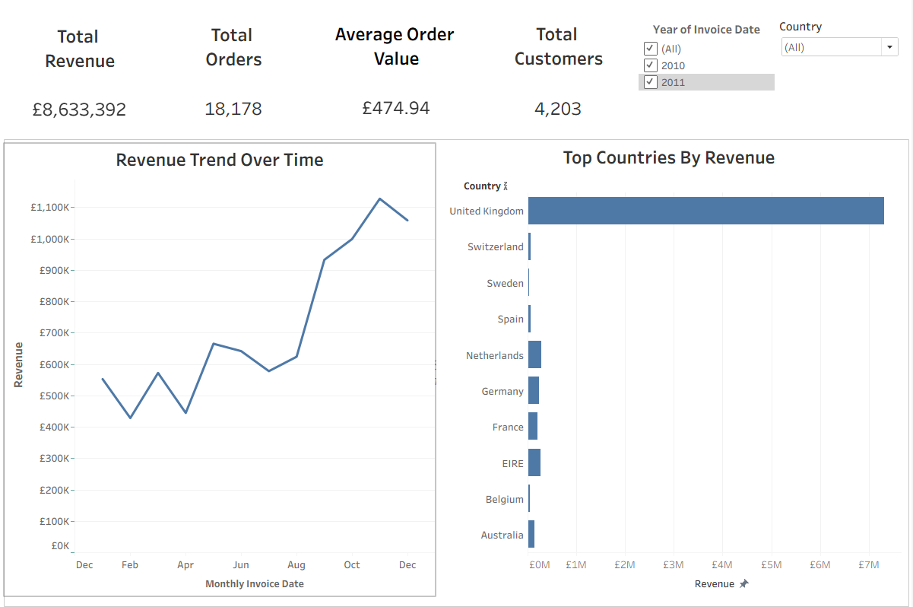
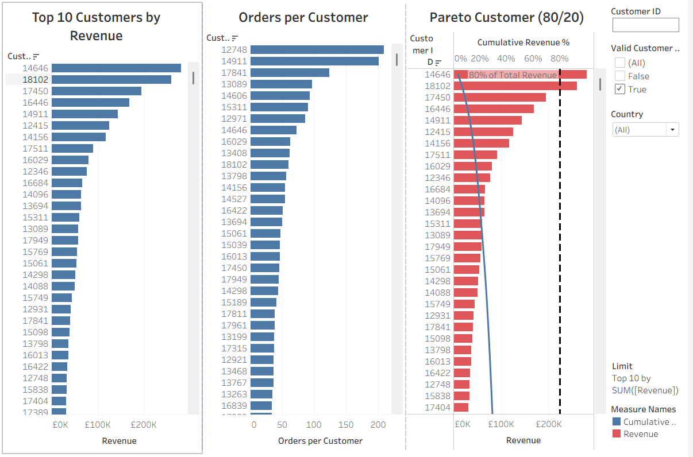
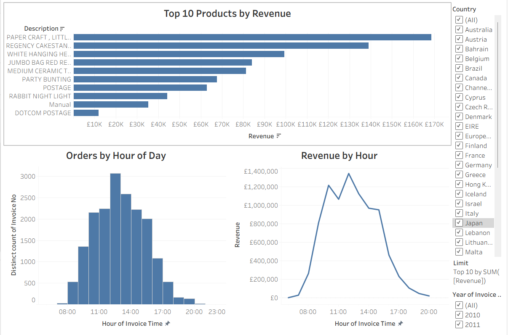

# Online Retail Sales Analysis

## Overview
This project analyses transactional data from an online retail business to uncover insights into revenue performance, customer behaviour, product contribution, and purchasing patterns over time.

The project demonstrates an end-to-end analytics workflow, from data cleaning and modelling in MySQL to interactive dashboard development in Tableau.

---

## Objectives
- Clean and prepare raw transactional data for analysis  
- Answer key business questions using SQL  
- Build interactive dashboards to support data-driven decision-making  

---

## Tools Used
- **MySQL** – Data cleaning, transformation, and analysis  
- **Tableau Desktop** – Visualisation and dashboard design  

---

## Key Business Questions
- How does revenue trend over time?  
- Who are the highest-value customers?  
- Which products generate the most revenue?  
- Which countries contribute the most revenue?  
- What is the average revenue per order?  
- When do customers place orders during the day?  
- How concentrated is revenue across customers (Pareto analysis)?  

---

## Dashboards
1. **Executive Overview** – High-level KPIs and revenue trends  
2. **Customer Insights** – Top customers and Pareto (80/20) analysis  
3. **Product & Time Insights** – Top products and purchasing behaviour by hour  

---

## Dashboard Previews

### Executive Overview

### Customer Insights

### Product & Time Insights

---

## Key Insights
- Revenue is highly concentrated among a small proportion of customers  
- A limited number of products drive a significant share of total revenue  
- Customer purchasing activity peaks during specific hours of the day  

---

## Files in This Repository
- `sql/` – SQL scripts for data cleaning and analysis  
- `tableau/` – Tableau workbook and dashboard screenshots  
- `data/` – Cleaned dataset (if sharing is permitted)  

Note: The full cleaned transactional dataset is not included in this repository due to file size constraints. All data preparation and transformation steps are fully documented in the SQL scripts.

---

## Author
**John Salter Oseyi**
