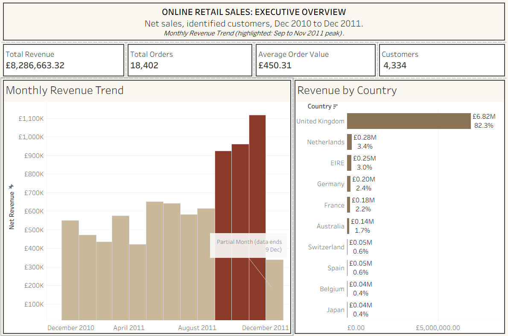
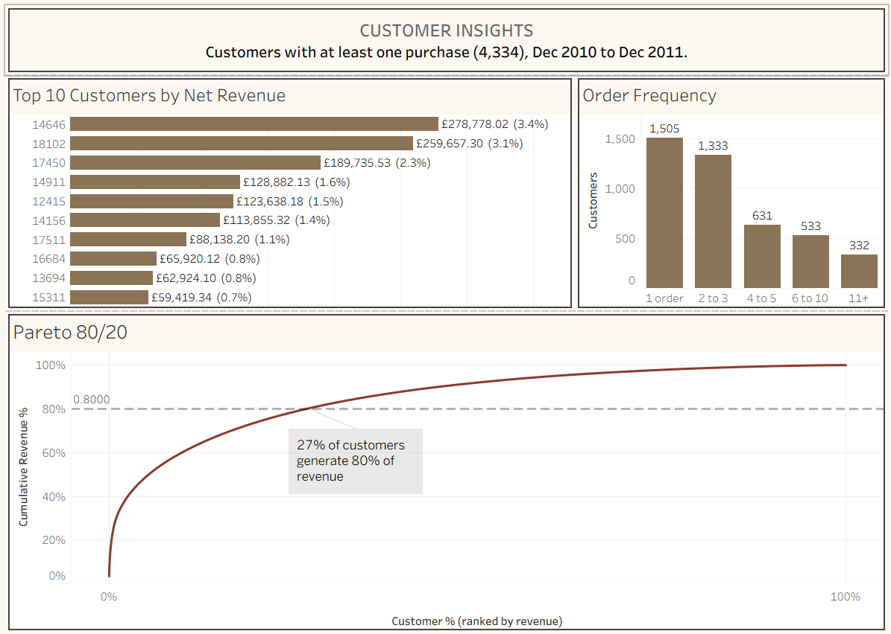
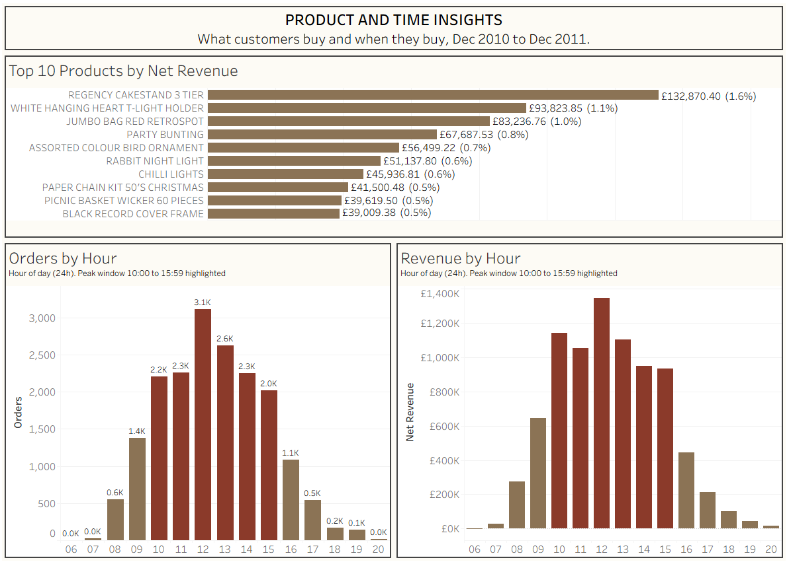

# Online Retail Sales Analysis
## Customer, Product and Seasonal Insights for a UK Wholesaler

**SQL and Tableau Portfolio Project | Data Analyst**

🔗 **Live dashboards:** [View on Tableau Public](PASTE_YOUR_TABLEAU_PUBLIC_LINK_HERE)

---

## Project Overview

An end-to-end analysis of 13 months of transaction data from a UK-based online gift and homeware wholesaler. Raw transactions were validated in Excel, cleaned and modelled in MySQL, analysed through seven business queries, and presented in three interactive Tableau dashboards with a written report of findings and recommendations.

---

## The Business Problem

The business sells mainly to trade buyers across 37 markets but had no clear view of where its revenue comes from or how dependent it is on a small group of customers.

**The analysis answers seven business questions:**

1. How does revenue trend over time?
2. Who are the highest-value customers?
3. Which products generate the most revenue?
4. Which countries contribute the most revenue?
5. What is the average revenue per order?
6. When do customers place orders during the day?
7. How concentrated is revenue across customers (Pareto analysis)?

---

## Dataset

| Item | Detail |
|---|---|
| Source | [UCI Machine Learning Repository: Online Retail](https://archive.ics.uci.edu/dataset/352/online+retail) |
| Period | 1 December 2010 to 9 December 2011 |
| Content | Invoice lines with product, quantity, unit price, customer ID, country and timestamp |
| Scope after cleaning | 4,334 customers, 18,402 orders, 3,907 products, 37 markets |

The raw and cleaned datasets are not stored in this repository because of their size. The source link above provides the original file.

---

## Key Findings

- **£8.29M net revenue** from 18,402 orders, an average of **£450 per order**
- **Strong seasonality:** September to November produced **36.3%** of revenue, with November at about **twice** the normal monthly level
- **Customer concentration:** **27%** of customers generate **80%** of revenue, and the top 10% generate 60%
- **Retention gap:** **34.7%** of customers bought only once
- **UK dependence:** the UK provides **82.3%** of revenue, while the Netherlands (£3,048 per order) and Australia (£2,446) behave like high-value wholesale markets
- **Daily pattern:** **78.7%** of orders arrive between 10:00 and 16:00

---

## Dashboard Screenshots

### Executive Overview


### Customer Insights


### Product and Time Insights


---

## Data Pipeline

```
Raw transactions (Excel)
   |  validation checks, helper columns to flag issues
   v
MySQL staging table
   |  date parsing, encoding fixes, strict-mode handling
   v
online_retail_clean (MySQL)
   |  net revenue, return flag, identified customers, product lines only
   v
Seven business queries (SQL)  --->  query outputs (CSV)
   |
   v
Tableau Public dashboards  --->  Business Insights Report (PDF)
```

**Cleaning rules applied in `Online_retail_clean.sql`:**

- Revenue is calculated as quantity x unit price, so **returns are kept as negative lines and deducted**, giving net revenue
- An `Is_Return` flag marks cancellation invoices, so order counts include genuine orders only
- Transactions without a customer ID are excluded so customer metrics are reliable
- Postage, fees and manual adjustment codes are excluded so product rankings reflect genuine products
- Zero and negative unit prices are excluded

---

## Challenges and How I Resolved Them

| Challenge | Resolution |
|---|---|
| Regional date formats (DD/MM/YYYY) and text encoding conflicts broke the MySQL import | Rebuilt the staging layer with explicit date parsing and a single source of truth for date and time fields |
| Missing customer IDs were loaded as `0` rather than null, so they passed a null filter | Added an explicit `CustomerID <> 0` rule and confirmed with a check query |
| Filtering out negative quantities removed returns instead of deducting them, overstating revenue | Kept returns as negative lines, added an `Is_Return` flag, and counted orders on genuine invoices only |
| Postage and adjustment codes appeared among the top "products" | Restricted the clean table to product codes and re-ranked products |
| Product descriptions containing quote marks broke the CSV import into Tableau | Stripped embedded quotes during export and verified the full row count in Tableau |

Every figure was reconciled across the SQL outputs, the Tableau dashboards and the report before publishing.

---

## Technical Stack

| Tool | Purpose |
|---|---|
| Microsoft Excel | Initial validation and rule-based checks |
| MySQL 8 | Data loading, cleaning, modelling and business queries |
| Tableau Public 2026.3 | Interactive dashboards and publishing |

**SQL techniques:** aggregation, `COUNT(DISTINCT CASE ...)`, window functions (`SUM() OVER` with `ROWS BETWEEN`), derived tables, data validation queries

**Tableau techniques:** calculated fields, `FIXED` level of detail expressions, table calculations (`RUNNING_SUM`, `WINDOW_SUM`, `INDEX`, `SIZE`), context and Top N filters, dashboard actions, annotations

---

## Dashboards

| Dashboard | Content | Questions answered |
|---|---|---|
| Executive Overview | KPI cards, monthly revenue trend with peak highlighted, top 10 countries with revenue share | Q1, Q4, Q5 |
| Customer Insights | Top 10 customers, order frequency bands, annotated Pareto curve | Q2, Q7 |
| Product and Time Insights | Top 10 products with revenue share, orders and revenue by hour | Q3, Q6 |

---

## Recommendations

Five recommendations grounded in the data are detailed in the Business Insights Report:

1. **Protect the top customers:** manage the top 10% (60% of revenue) as named accounts with lapse alerts
2. **Convert one-time buyers:** structured follow-up for first-time customers, tracked through second-order conversion
3. **Prepare earlier for the autumn peak:** plan stock and staffing for roughly double throughput from September
4. **Test wholesale export growth:** pilot outreach in high-value markets such as the Netherlands and Australia before scaling
5. **Align marketing and operations to the daily order window:** time campaigns for 09:00 to 10:00 and staff for 10:00 to 16:00

Full findings and recommendations: [Online_Retail_Business_Insights_Report.pdf](Online_Retail_Business_Insights_Report.pdf)

---

## Repository Structure

```
online-retail-sales-analysis/
|
+-- README.md
+-- Online_Retail_Business_Insights_Report.pdf
+-- Online_Retail_Sales_Analysis_Explained.pdf
|
+-- sql/
|   +-- Online_retail_clean.sql
|   +-- Q1_monthly_revenue.sql
|   +-- Q2_top_customers.sql
|   +-- Q3_top_products.sql
|   +-- Q4_revenue_by_country.sql
|   +-- Q5_average_order_value.sql
|   +-- Q6_orders_by_hour.sql
|   +-- Q7_pareto_customers.sql
|
+-- query_outputs/
|   +-- Q1_monthly_revenue.csv ... Q7_pareto_customers.csv
|
+-- screenshots/
    +-- executive_overview.png
    +-- customer_insights.png
    +-- product_time_insights.png
```

---

## Limitations

- No cost or margin data, so recommendations are based on revenue rather than profit
- 13 months from a single retailer, so the seasonal pattern rests on one autumn
- Customer metrics cover identified customers only

---

## About the Analyst

**John Salter Oseyi** is a Data Analyst with a Civil Engineering and HSE background, combining operational domain expertise with SQL, Tableau and Power BI capability to turn data into decisions.

- LinkedIn: [linkedin.com/in/johnsalteroseyi](https://linkedin.com/in/johnsalteroseyi)
- Email: john.salteroseyi@outlook.com
- Location: Leeds, England, UK

---

*Dataset: Online Retail, UCI Machine Learning Repository. Analysis completed in MySQL and Tableau Public, November 2026.*
